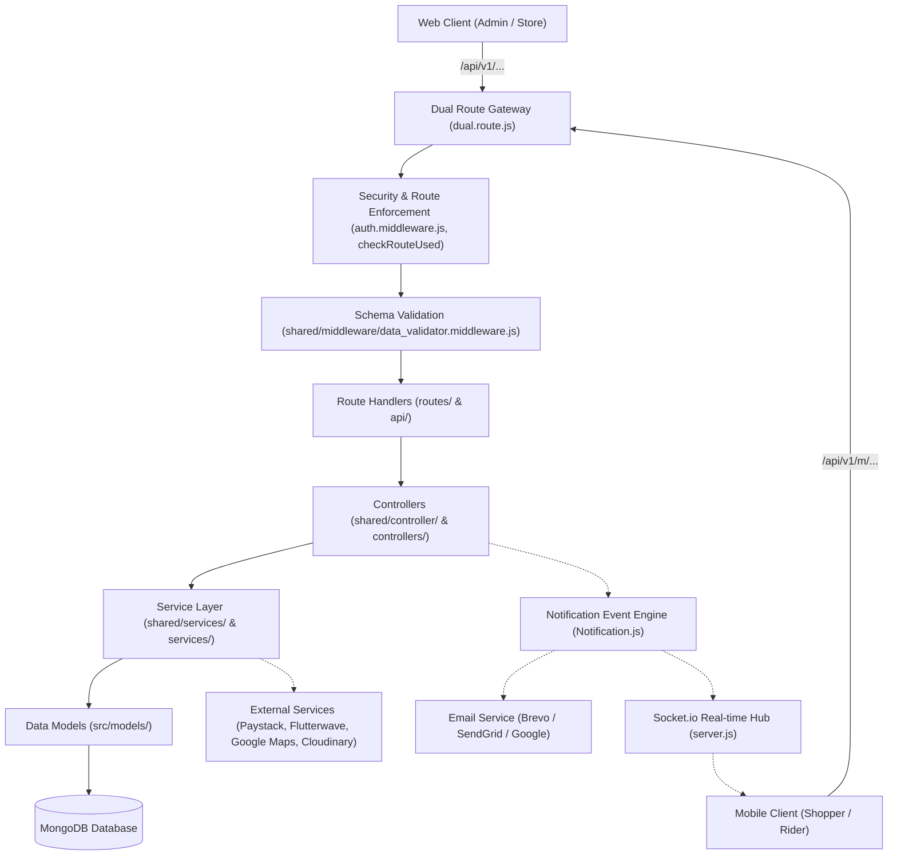
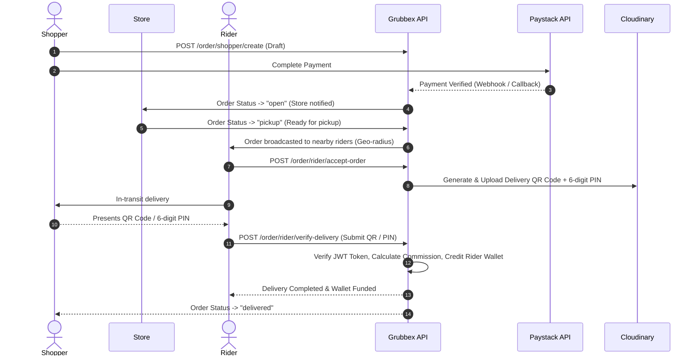

# Grubbex Backend API — Project Architecture & Map

## 1. System Overview

**Grubbex** is a multi-sided marketplace and logistics platform designed for food, grocery, and multi-category deliveries. The backend provides a RESTful API and real-time Socket.io service supporting four distinct client personas:

- **Shoppers (Customers)**: Browse stores/products, manage carts, save items, checkout via cards/wallet, track deliveries in real time, and confirm receipt.
- **Riders (Couriers)**: Receive nearby delivery orders within a geo-radius, accept/reject deliveries, navigate to stores and shopper locations, scan QR codes/enter 6-digit delivery PINs for handover, and receive wallet earnings.
- **Businesses (Vendors / Stores)**: Manage store profile, category taxonomy, catalog/product inventory, order preparation states, and request revenue payouts.
- **Platform Administrators**: Manage KYC compliance, store approvals, system configurations, payouts, commissions, disputes/tickets, FAQs, and platform analytics.

---

## 2. High-Level Architecture

The server employs an Express.js layered architecture with dual client routing (Web vs. Mobile enforcement), centralized Zod validation, role-based access control, an event-driven notification engine, and Mongoose ORM data access.



---

## 3. Directory Structure Map

```
grubbex-BE/
├── server.js                          # Application bootstrap, Socket.io setup, HTTP listener, DB init
├── secret.loader.js                   # Secret manager loader (AWS Secrets Manager)
├── entities_def.txt                   # High-level entity schema definitions reference
├── package.json                       # Dependencies & npm scripts
│
└── src/
    ├── app.js                         # Express app configuration, CORS whitelisting, rate limiting
    ├── config/                        # Configuration & constants
    │   ├── env.js                     # Environment variables loader
    │   ├── index.js                   # Application constants, role enums, order statuses
    │   └── db.config.js               # MongoDB connection logic
    │
    ├── middlewares/                   # Core request pipeline middlewares
    │   ├── auth.middleware.js         # JWT verification, web/mobile route checks, role validation
    │   ├── error.middleware.js        # Global error interceptor and response formatting
    │   └── index.js
    │
    ├── logger/                        # Logging configuration (Winston & Winston-MongoDB)
    │   ├── dev.logger.js
    │   ├── production.logger.js
    │   └── index.js
    │
    ├── models/                        # Mongoose schemas & data models (30+ entities)
    │   ├── account.model.js           # Users, admins, riders, store owners
    │   ├── order.models.js            # Core order lifecycle & status tracking
    │   ├── product.model.js           # Store inventory items & pricing
    │   ├── store.model.js             # Merchant store entity & KYC relation
    │   ├── kyc.model.js               # Rider & Store identity & bank verification
    │   ├── wallet.model.js            # User/rider/admin wallet balance
    │   ├── wallet.history.model.js    # Financial transactions & ledger history
    │   ├── payout.model.js            # Store & Rider payout requests
    │   ├── ticket.model.js            # Support desk tickets & messaging
    │   └── ... (see Domain Entities)
    │
    ├── routes/                        # Express API route modules
    │   ├── dual.route.js              # Web vs. Mobile root router (/api/v1 vs /api/v1/m)
    │   ├── index.js                   # Route aggregators (Router & MobileRouter)
    │   ├── auth.route.js              # Authentication, registration, OTP, password recovery
    │   ├── user.route.js              # User profiles, notifications, 2FA, settings
    │   ├── order.route.js             # Order routing split into shopper, rider, store, admin
    │   ├── shopper.order.route.js     # Shopper order creation, checkout, tracking
    │   ├── rider.order.route.js       # Rider order polling, acceptance, pickup, completion
    │   ├── business.order.route.js    # Merchant order processing & status updates
    │   ├── admin.order.route.js       # Admin oversight, order inspection
    │   ├── payment.route.js           # Wallet, checkout, bank verification
    │   ├── transaction.route.js       # Paystack confirmation, verify & history
    │   ├── payout.route.js            # Payout requests & processing
    │   ├── location.route.js          # Courier GPS & geofencing
    │   ├── business.route.js          # Store management & KYC routes
    │   ├── rider.route.js             # Rider specific routes
    │   └── admin.route.js             # Administrative endpoints
    │
    ├── shared/                        # Shared cross-cutting modules & controllers
    │   ├── controller/                # Central business controllers
    │   │   ├── order.controller.js    # Core order lifecycle, QR verification, commissions
    │   │   ├── account.controller.js  # Account profiles, 2FA, password resets
    │   │   ├── auth.controller.js     # Auth, session & token operations
    │   │   ├── payout.controller.js   # Merchant and courier payouts
    │   │   ├── report.controller.js   # Sales trends, platform performance, analytics
    │   │   └── ...
    │   ├── middleware/                # Validation middlewares (Zod integration)
    │   │   └── data_validator.middleware.js # Schema validation & role checks
    │   ├── schema/                    # Zod schemas for payload validation
    │   │   ├── order.schema.js
    │   │   ├── account.schema.js
    │   │   ├── payout.schema.js
    │   │   └── ...
    │   ├── services/                  # Database service layer & 3rd-party clients
    │   │   ├── order.service.js
    │   │   ├── paystack.payment.services.js
    │   │   ├── flutter.payment.services.js
    │   │   ├── google.service.js      # Geocoding & distance matrix calculations
    │   │   └── ...
    │   └── utils/                     # Utility helpers (Notification EventEmitter, QR generation, mailers)
    │
    ├── api/                           # Domain-specific modular sub-packages
    │   ├── admin/                     # Admin account controllers & invitation service
    │   ├── business/                  # Business onboarding & store schemas
    │   └── store/                     # Store category & product catalog management
    │
    ├── utils/                         # Global helpers (Cloudinary upload, Paystack, response builders)
    └── views/                         # Handlebars email & web receipt/policy templates
```

---

## 4. Persona & Route Ecosystem

Grubbex enforces platform isolation via `checkRouteUsed` in [auth.middleware.js](file:///c:/Users/LearnuelTech/Desktop/PROJECTS/grubbex-final-app/grubbex-BE/src/middlewares/auth.middleware.js#L241-L251):

| Persona | Allowed Gateway | Enforced App Mode | Primary Responsibilities & Endpoints |
| :--- | :--- | :--- | :--- |
| **Shopper** | `/api/v1/m` | Mobile Only | • Product discovery: `/api/v1/m/item`<br>• Order placement & checkout: `/api/v1/m/order/shopper`<br>• Shipping addresses: `/api/v1/m/order/shopper/shipping-address`<br>• Order receipt verification code / QR: `/api/v1/m/order/shopper/qr-code` |
| **Rider** | `/api/v1/m` | Mobile Only | • KYC onboarding: `/api/v1/m/rider/kyc`<br>• View nearby/available orders: `/api/v1/m/order/rider/orders`<br>• Accept/Reject delivery: `/api/v1/m/order/rider/accept-order`<br>• Confirm delivery via QR scan / 6-digit PIN: `/api/v1/m/order/rider/verify-delivery`<br>• Location updates: `/api/v1/m/location/update` |
| **Store / Business** | `/api/v1` | Web Only | • Store profile & KYC: `/api/v1/business/store`, `/api/v1/business/kyc`<br>• Product catalog: `/api/v1/business/product`<br>• Store orders & status update: `/api/v1/order/store`<br>• Payout requests: `/api/v1/payout` |
| **Admin** | `/api/v1` | Web Only | • Admin order oversight: `/api/v1/admin/order`<br>• Store & Rider KYC approvals: `/api/v1/admin/kyc`<br>• Payout approvals & transfers: `/api/v1/admin/payout`<br>• Platform analytics & sales reports: `/api/v1/report`<br>• Platform settings & templates: `/api/v1/admin/setting` |

---

## 5. Core Workflows & Business Logic

### A. Order Lifecycle & Secure Handover



### B. Financial Ledger & Wallet Logic
1. **Shopper Checkout**: Shoppers pay via Paystack (card, transfer) or Grubbex Wallet balance.
2. **Platform Escrow**: Payment is received into platform escrow; order status advances to `open`.
3. **Delivery Handover & Settlement** in [order.controller.js](file:///c:/Users/LearnuelTech/Desktop/PROJECTS/grubbex-final-app/grubbex-BE/src/shared/controller/order.controller.js#L2070-L2090):
   - Commission is deducted: `deliveryPrice * (ORDER_SERVICE_CHARGE_PERCENTAGE / 100)`.
   - Rider's wallet is credited: `balance += (deliveryPrice - commission)`.
   - Transaction ledger entries created in `WalletHistory`.
4. **Merchant & Courier Payout**:
   - Merchants and riders request withdrawals via `/payout`.
   - Admins approve and trigger transfers via Paystack Transfer API (`initiateTransfer` / `finalizeTransfer`).

### C. Event-Driven Notification System
Located in [Notification.js](file:///c:/Users/LearnuelTech/Desktop/PROJECTS/grubbex-final-app/grubbex-BE/src/shared/utils/Notification.js):
- Subscribes to events: `notify`, `systemLoaded`, `systemNotify`, `emailer`, `deleteAccount`, `orderPayment`.
- Dispatches transactional emails via Brevo, SendGrid, or Google Mail.
- Writes persistent in-app notifications to `Notification` model.

---

## 6. Key Domain Models Reference

| Entity Model | File | Description |
| :--- | :--- | :--- |
| `Account` | [account.model.js](file:///c:/Users/LearnuelTech/Desktop/PROJECTS/grubbex-final-app/grubbex-BE/src/models/account.model.js) | Central identity model for all personas (`shopper`, `rider`, `business`, `admin`, `dev`) with role flags, 2FA status, and balance. |
| `Order` | [order.models.js](file:///c:/Users/LearnuelTech/Desktop/PROJECTS/grubbex-final-app/grubbex-BE/src/models/order.models.js) | Primary order entity linking shopper, store, rider, items, delivery destination, pricing, auth tokens, and QR code data. |
| `Product` | [product.model.js](file:///c:/Users/LearnuelTech/Desktop/PROJECTS/grubbex-final-app/grubbex-BE/src/models/product.model.js) | Merchant catalog items with variants, pricing, inventory barcodes, media, and ratings. |
| `Store` | [store.model.js](file:///c:/Users/LearnuelTech/Desktop/PROJECTS/grubbex-final-app/grubbex-BE/src/models/store.model.js) | Merchant profile with physical coordinates, operating hours, categories, and owner link. |
| `KYC` | [kyc.model.js](file:///c:/Users/LearnuelTech/Desktop/PROJECTS/grubbex-final-app/grubbex-BE/src/models/kyc.model.js) | Compliance identity records: Virtual NIN, Voter's Card, Driver's License, CAC, TIN, bank accounts. |
| `Wallet` / `WalletHistory` | [wallet.model.js](file:///c:/Users/LearnuelTech/Desktop/PROJECTS/grubbex-final-app/grubbex-BE/src/models/wallet.model.js) | Double-entry transaction history tracking balances, credits, debits, order IDs, and payment references. |
| `Payout` | [payout.model.js](file:///c:/Users/LearnuelTech/Desktop/PROJECTS/grubbex-final-app/grubbex-BE/src/models/payout.model.js) | Withdrawal requests for stores and riders with bank destination details and status (`pending`, `completed`, `issue`). |
| `ShippingAddress` | [shipping.address.schema.js](file:///c:/Users/LearnuelTech/Desktop/PROJECTS/grubbex-final-app/grubbex-BE/src/models/shipping.address.schema.js) | Shopper delivery addresses with coordinates and primary address selection. |
| `Ticket` & `Chat` | [ticket.model.js](file:///c:/Users/LearnuelTech/Desktop/PROJECTS/grubbex-final-app/grubbex-BE/src/models/ticket.model.js) | Support ticketing system with nested message threads for user dispute resolution. |

---

## 7. External Integrations & Services

```
┌─────────────────────────────────────────────────────────────┐
│                       Grubbex Backend                       │
└──────┬──────────────┬──────────────┬──────────────┬─────────┘
       │              │              │              │
       ▼              ▼              ▼              ▼
┌──────────────┐┌──────────────┐┌──────────────┐┌──────────────┐
│  Paystack &  ││ Google Maps  ││ Cloudinary & ││ Brevo,       │
│ Flutterwave  ││ Platform     ││ AWS S3       ││ SendGrid &   │
│ Payment &    ││ Geocoding &  ││ Image Assets ││ Nodemailer   │
│ Payout API   ││ Distance     ││ & QR Codes   ││ Transactional│
│              ││ Matrix       ││              ││ Emails       │
└──────────────┘└──────────────┘└──────────────┘└──────────────┘
```

- **Paystack & Flutterwave**: Card checkout, bank account verification (`/api/v1/payment/verify-account`), recipient code creation, and automated fund transfers.
- **Google Maps API**: Lat/long geocoding, address verification, and Haversine distance calculations for rider geo-radius order distribution (`getOrdersWithinRadius`).
- **Cloudinary & AWS S3**: Product imagery, KYC document uploads, and dynamically generated QR code badges (`qrcodeService`).
- **Brevo / SendGrid / Nodemailer**: Delivery confirmations, OTP verification, password resets, and admin critical system notifications.
- **Socket.io**: Real-time rider location broadcasting, live order tracking, and chat messaging.

